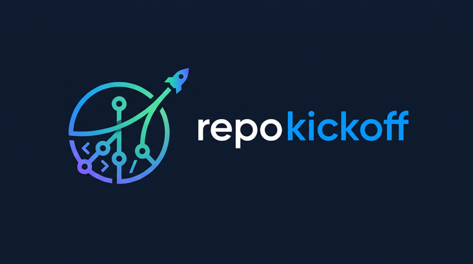

# repo-kickoff



A [Claude Code](https://code.claude.com) skill that sets up new repositories properly and checks existing ones. A **skill** is a set of instructions plus small scripts that Claude loads only when a request needs them; you do not call it by name.

It has two modes:

| Mode | You say | You get |
|---|---|---|
| **Kickoff** | "new project", "set up the repo", "yeni proje" | A git repository with a `main` branch, GitHub's `.gitignore` template, dependencies pinned to the exact versions your tests passed with, the Python version written down, a check that refuses commits containing API keys or passwords, a README, and (if you agree) a private GitHub repository with a pull request. |
| **Audit** | "audit this repo", "does the README match the code", "repoyu denetle" | A read-only report: imports missing from `requirements.txt`, no stated Python version, README references to files or lines that do not exist, files tracked although `.gitignore` ignores them, secrets already committed. Nothing is changed. |

It is written for Python projects; the git, `.gitignore`, secret-check and README parts work for any language.

## Install

Requirements: [Claude Code](https://code.claude.com), git, and Python **3.11 or later**. Check with `python --version` (on macOS and Linux the command is often `python3`; on Windows it must print a version, not open the Microsoft Store). Optional: the GitHub CLI `gh`, signed in with `gh auth login`, for the GitHub step.

In a terminal:

```
claude plugin marketplace add Sarpes/repo-kickoff
claude plugin install repo-kickoff@repo-kickoff
```

Then start a **new** Claude Code session. `claude plugin list` should show `repo-kickoff@repo-kickoff` as enabled.

Inside a session, `/plugin` opens the plugin manager, where you can add the marketplace `Sarpes/repo-kickoff` and install from it. Without the plugin system, copy the folder `skills/repo-kickoff/` to `~/.claude/skills/repo-kickoff/`.

Update: `claude plugin marketplace update repo-kickoff`, then `claude plugin update repo-kickoff@repo-kickoff`. Remove: `claude plugin uninstall repo-kickoff@repo-kickoff`.

## Try it

- **Audit**: open Claude Code in one of your existing repositories and say *"audit this repo"*. You get findings by severity (`high`, `medium`: fix before pushing; `verify`: a README line Claude opens and compares; `low`, `info`), each with a file and line.
- **Kickoff**: in an empty folder, say *"new project: a script that …"*. Claude first confirms the project name and folder with you, then works through the steps. The last step creates a **private** GitHub repository and pushes to it. Claude Code shows each command for your permission unless you have allowed it in advance; if you do not want GitHub, say so in your request (*"no GitHub"*).

## Feedback

This is an early version and feedback is welcome: what worked, what was confusing, false alarms in the audit, what you missed. Open an [issue](https://github.com/Sarpes/repo-kickoff/issues) and include your operating system and Claude Code version (`claude --version`).

## Why

Measured on a small Python project ("kur-takip": TCMB daily exchange rates → SQLite), three fresh Claude Code sessions each. Without the skill, agents wrote good code and tests but skipped the parts that make a repository reproducible and safe:

| Criterion | Without skill | With skill |
|---|---|---|
| Dependencies pinned to the versions the tests ran with | 0/3 | 3/3 |
| Python version stated | 1/3 | 3/3 |
| Secret gate that exists as code (not "I scanned") | 0/3 | 3/3 |
| `main` exists before the first branch | 2/3 | 3/3 |
| Audit findings (high + medium) | 1 per repo | 0 |

In audit mode, one of two sessions without the skill sampled the README's 29 `file:line` references and missed the one stale reference; with the skill, both checked all 29 and caught it.

**Pinned** means `requirements.txt` records exact versions (`requests==2.33.0`) instead of ranges, so another machine installs what you tested. The **secret gate** is a git pre-commit hook: a small program git runs before every commit, which refuses the commit if a staged file looks like it contains a credential.

## What it runs, fetches and sends

Everything below happens on your machine, with your own tools and credentials, and only when you ask for a kickoff or an audit.

| | What | Where |
|---|---|---|
| **Runs** | `git` (init, commit, branch, push) and the Python scripts in `skills/repo-kickoff/scripts/`. The scripts use only Python's standard library, call no program but `git`, and contain no network code. | your machine |
| **Reads** | The files of the repository you point it at and, in audit mode, their earlier versions in its git history, and (for `pin_requirements.py`) the installed-package list of the Python you run it with. It does not read your environment variables or credential files; it looks for credential-shaped file names and lines only to warn about them, and prints file names and line numbers, never values. | your machine |
| **Fetches** | GitHub's official `.gitignore` template, through `gh api /gitignore/templates/<Language>` with your own `gh` login (kickoff step 2). | GitHub |
| **Sends** | Only in kickoff step 8, through commands Claude Code shows for your permission unless you allowed them in advance (say *"no GitHub"* to skip the step): `gh repo create` makes a **private** repository under the owner you choose, and `git push` uploads your project to it, with your own credentials. Audit mode sends nothing. | GitHub |
| **Installs** | Into the new repository only: `.githooks/pre-commit` and `.githooks/secret_gate.py`, `git config core.hooksPath .githooks`, one `.gitattributes` line, and `.githooks/pre-commit` staged as executable so the hook also runs on macOS and Linux. The gate runs locally on each commit and reads only the staged files. | the repository |

No telemetry, no other services, nothing stored outside the repository you work on. Privacy policy: [PRIVACY.md](PRIVACY.md).

## The scripts on their own

The skill calls these, and they also run without Claude (Python 3.11+, standard library only):

| Script | What it does |
|---|---|
| `skills/repo-kickoff/scripts/audit_repo.py <repo>` | Read-only audit: imports vs requirements, Python version, README `file:line` references, ignored-but-tracked files, secrets in the current files and in the git history. Exit 1 on high/medium findings. |
| `skills/repo-kickoff/scripts/pin_requirements.py <repo> [--write]` | Run with the project's venv interpreter: writes `requirements.txt` / `requirements-dev.txt` with `==` pins and `.python-version`. |
| `skills/repo-kickoff/scripts/install_secret_gate.py <repo>` | Proves the pre-commit secret gate on a throwaway repo, then installs it (`.githooks/`, `core.hooksPath`, LF line endings via `.gitattributes`). |

Tests:

```
python skills/repo-kickoff/scripts/test_audit_repo.py
python skills/repo-kickoff/scripts/test_secret_gate.py
```

Both build throwaway repos with planted defects and check each one is caught, and that a clean variant raises nothing. `test_secret_gate.py` also checks that the gate and `audit_repo.py` use identical secret patterns.

Contributing: after cloning this repository, run `git config core.hooksPath .githooks` once, so its own secret gate checks your commits. Git does not turn hooks on by itself after a clone.

## More

- **User guide:** [docs/GUIDE.md](docs/GUIDE.md): each kickoff step and why it exists, the audit checks, the secret gate in daily use, installing on several machines, troubleshooting.
- **Changes:** [CHANGELOG.md](CHANGELOG.md).

| Path | What |
|---|---|
| `skills/repo-kickoff/SKILL.md` | The skill: order of steps and the judgment calls |
| `skills/repo-kickoff/scripts/` | Deterministic steps and their tests |
| `.claude-plugin/` | Plugin and marketplace manifests |
| `.githooks/` | This repo's own secret gate, installed by its own script |
| `docs/GUIDE.md` | User guide |
| `CHANGELOG.md` | What changed in each version |

## License

[MIT](LICENSE) © 2026 Sarp Esenyel.
